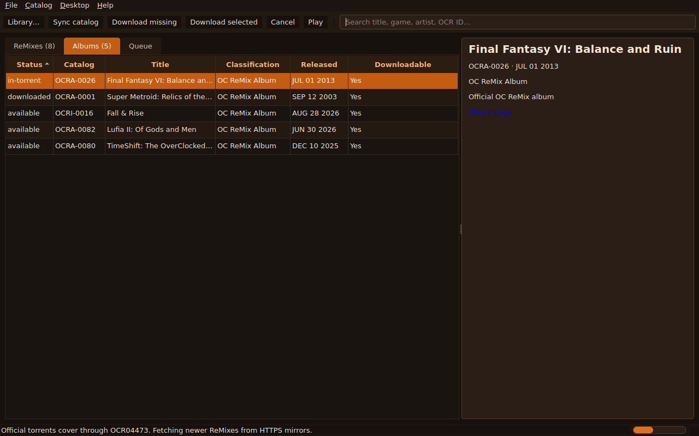
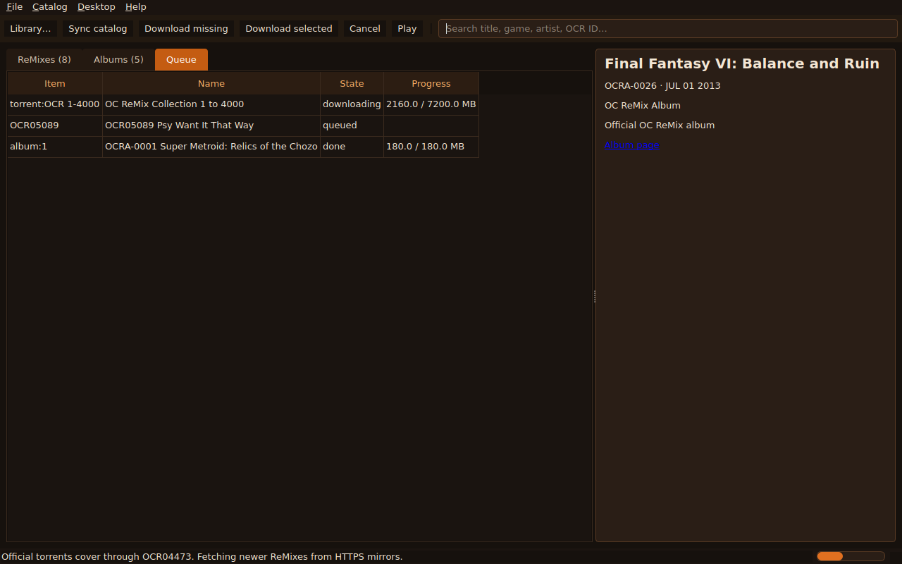

# OCR Catalog

A desktop app for the public [OC ReMix](https://ocremix.org/) library. Search remixes and official albums, keep a local catalog, and download what you do not already have.

OCR Catalog is not affiliated with OverClocked ReMix. It only uses download links the site already publishes, and it stays polite about request rates.


## Download

Use a ready-made build from [Releases](https://github.com/dark1ltg/overclocked-tunes/releases/latest).

| You use | Grab this |
| --- | --- |
| Linux | `OCRCatalog-v1.0.2-x86_64.AppImage` from [v1.0.2](https://github.com/dark1ltg/overclocked-tunes/releases/tag/v1.0.2) |
| Windows | `OCRCatalog-v1.0.0-setup.exe` from [v1.0.0](https://github.com/dark1ltg/overclocked-tunes/releases/tag/v1.0.0) |
| macOS | `OCRCatalog-v1.0.2-macos.dmg` from [v1.0.2](https://github.com/dark1ltg/overclocked-tunes/releases/tag/v1.0.2) |

Each one is a self-contained app. Qt and the libraries it needs are inside the file. GitHub also attaches source zip/tar.gz on that page; those are the code, not the app.

On Linux, mark the AppImage executable and run it. **Desktop → Install to application menu** puts it in KDE Plasma, GNOME, and other Freedesktop menus.

## Using it

First launch looks like this until you sync:


1. **Library…** — pick a folder for music, albums, and official torrents.
2. **Sync catalog** — pulls the public remix and album lists into a local SQLite catalog.
3. Search by title, game, artist, or OCR ID.
4. **Download missing** — the two official collection torrents first (and waits until both finish), then album torrents one by one, then leftover tracks one by one. Tracks already pulled from those torrents are skipped.
5. Select a row for details. **Play / Resume** plays a downloaded MP3, or resumes a paused/cancelled item on the Queue tab. Closing the app stops in-app torrents and HTTPS downloads so they do not keep using the network.



**Download missing** starts with the two official packs OC ReMix publishes for the back-catalog:

- [OCR 1–4000](https://bt.ocremix.org/torrents/OC_ReMix_Collection_-_1_to_4000_[v20201028].torrent)
- [OCR 4001–4473](https://bt.ocremix.org/torrents/OC_ReMix_Collection_-_4001_to_4473_(Q2_2023_update).torrent)

Linux and macOS v1.0.2 builds fetch those torrents **inside the app** (libtorrent). Only files from `https://bt.ocremix.org/torrents/` are accepted. There is no magnet box and no way to add other torrents. The current Windows installer is still [v1.0.0](https://github.com/dark1ltg/overclocked-tunes/releases/tag/v1.0.0); it saves the official `.torrent` files so you can open them in qBittorrent, Transmission, or Deluge.

After both collection packs finish, album torrents run one at a time. Then leftover remixes (typically after OCR 4473) download over HTTPS, one at a time, skipping anything already on disk from those torrents. A ZIP is used for an album only when there is no official torrent. Closing the app stops in-app torrents and HTTPS transfers so they do not keep using the network; torrent resume data and partial HTTPS files are saved so the next launch can continue from there.



This is not a general BitTorrent client. If you turn off in-app torrents in Settings, the official `.torrent` files are still saved so you can open them in qBittorrent, Transmission, or Deluge.


## Library folder

```
library/
  remixes/       MP3s fetched from HTTPS mirrors
  albums/        album ZIPs when a ZIP mirror exists
  torrents/      official collection and album .torrent files
  collections/   files the in-app engine writes from those torrents
```

The catalog database lives in the Qt app-data directory, not in this folder. Files you already have are skipped.

## Building from source

Skip this unless you are changing the code. Everyone else should use the release files above.

You need CMake 3.16+, a C++17 compiler, Qt 6 (Widgets, Network, Sql/SQLite, Svg), and libtorrent-rasterbar for in-app official torrents. Optional: Qt Multimedia for in-app playback. On Windows the release build uses vcpkg (`vcpkg.json`). On macOS, Homebrew `libtorrent-rasterbar` is enough.

```bash
git clone https://github.com/dark1ltg/overclocked-tunes.git
cd overclocked-tunes
cmake -S . -B build -DCMAKE_BUILD_TYPE=Release
cmake --build build
```

The binary is `build/OCRCatalog` (Linux), `build/OCRCatalog.exe` (Windows), or `build/OCRCatalog.app` (macOS). Release packaging scripts live under `packaging/` if you are cutting a new GitHub release.
