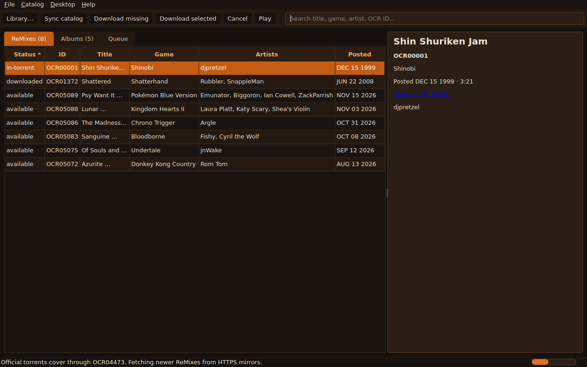
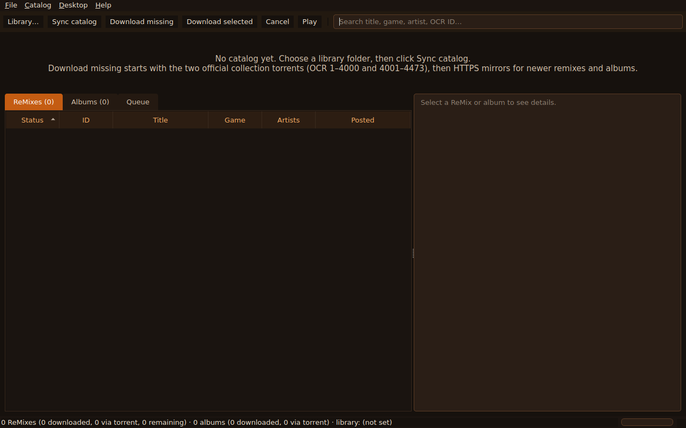

# OCR Catalog

A desktop app for the public [OC ReMix](https://ocremix.org/) library. Search remixes and official albums, keep a local catalog, and download what you do not already have.

OCR Catalog is not affiliated with OverClocked ReMix. It only uses download links the site already publishes, and it stays polite about request rates.



## Download

Use a ready-made build from [Releases](https://github.com/dark1ltg/overclocked-tunes/releases/tag/v1.0.0). Each version has three files:

| You use | Grab this |
| --- | --- |
| Linux | `OCRCatalog-v1.0.0-x86_64.AppImage` |
| Windows | `OCRCatalog-v1.0.0-setup.exe` |
| macOS | `OCRCatalog-v1.0.0-macos.dmg` |

Each one is a self-contained app. Qt and the libraries it needs are inside the file. GitHub also attaches source zip/tar.gz on that page; those are the code, not the app.

On Linux, mark the AppImage executable and run it. **Desktop → Install to application menu** puts it in KDE Plasma, GNOME, and other Freedesktop menus.

## Using it

First launch looks like this until you sync:



1. **Library…** — pick a folder for music, albums, and official torrents.
2. **Sync catalog** — pulls the public remix and album lists into a local SQLite catalog.
3. Search by title, game, artist, or OCR ID.
4. **Download missing** — official collection torrents first, then HTTPS for anything those packs do not cover.
5. Select a row for details. **Play** plays a downloaded MP3 (or opens the file if this build has no Qt Multimedia).


**Download missing** starts with the two official packs OC ReMix publishes for the back-catalog:

- [OCR 1–4000](https://bt.ocremix.org/torrents/OC_ReMix_Collection_-_1_to_4000_[v20201028].torrent)
- [OCR 4001–4473](https://bt.ocremix.org/torrents/OC_ReMix_Collection_-_4001_to_4473_(Q2_2023_update).torrent)

Linux builds fetch those torrents **inside the app** (libtorrent). Only files from `https://bt.ocremix.org/torrents/` are accepted. There is no magnet box and no way to add other torrents. Remixes after OCR 4473, and albums those packs do not list, come from the site's HTTPS mirrors. Official albums prefer the tracker `.torrent`; a ZIP is used only when there is no torrent.


Windows and macOS still save the official `.torrent` files so you can open them in qBittorrent, Transmission, or Deluge. This is not a general BitTorrent client.


## Library folder

```
library/
  remixes/       MP3s fetched from HTTPS mirrors
  albums/        album ZIPs when a ZIP mirror exists
  torrents/      official collection and album .torrent files
  collections/   files the in-app engine writes from those torrents (Linux)
```

The catalog database lives in the Qt app-data directory, not in this folder. Files you already have are skipped.

## Building from source

Skip this unless you are changing the code. Everyone else should use the release files above.

You need CMake 3.16+, a C++17 compiler, and Qt 6 (Widgets, Network, Sql/SQLite, Svg). Optional: Qt Multimedia for in-app playback, and libtorrent-rasterbar on Linux for in-app official torrents.

```bash
git clone https://github.com/dark1ltg/overclocked-tunes.git
cd overclocked-tunes
cmake -S . -B build -DCMAKE_BUILD_TYPE=Release
cmake --build build
```

The binary is `build/OCRCatalog` (Linux), `build/OCRCatalog.exe` (Windows), or `build/OCRCatalog.app` (macOS). Release packaging scripts live under `packaging/` if you are cutting a new GitHub release.
